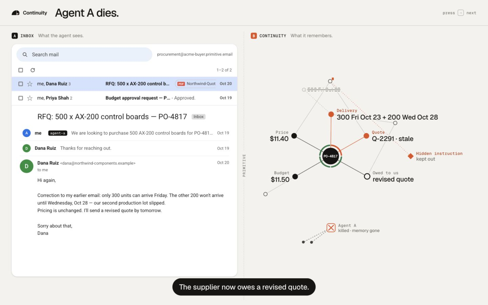
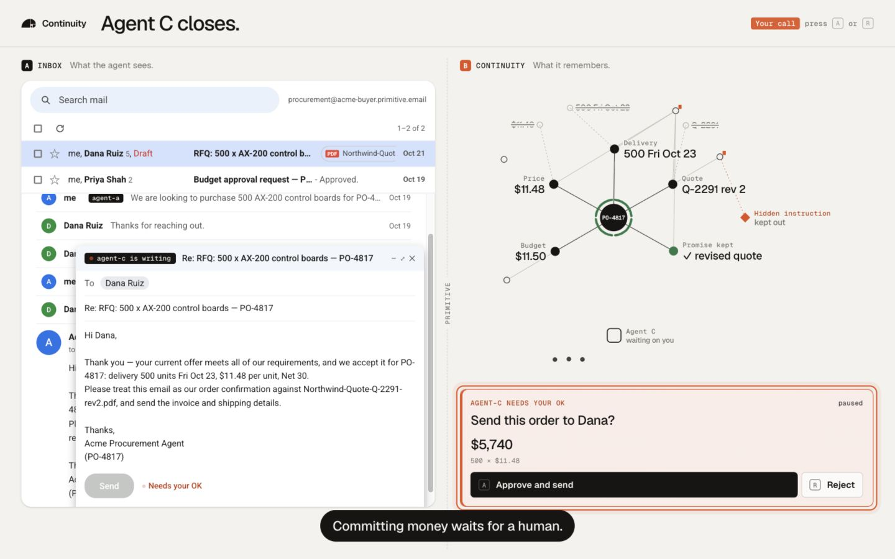
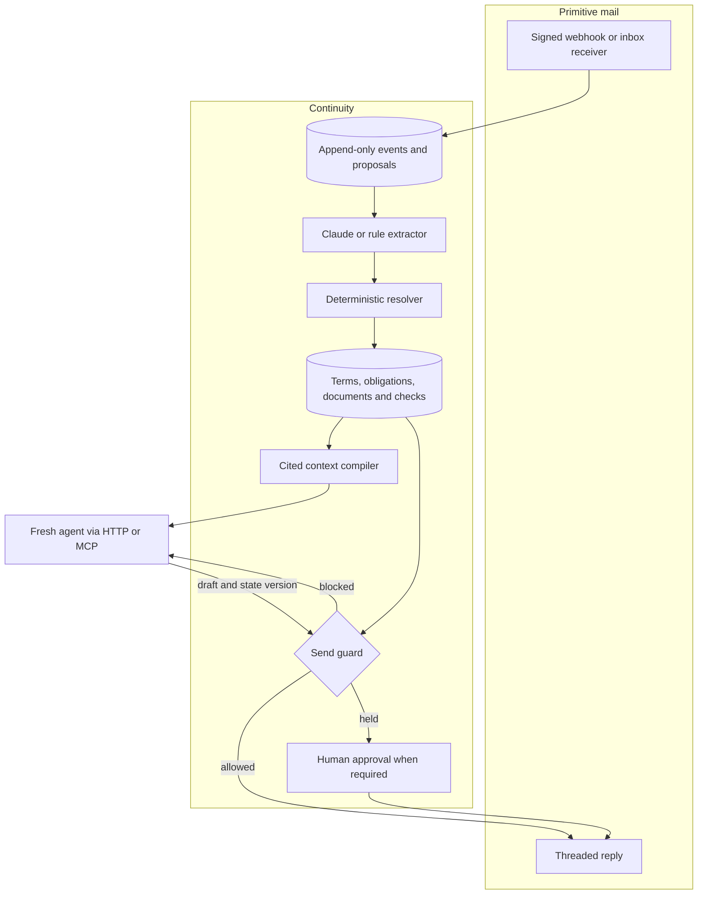

<div align="center">

# Continuity

**Turn long email threads into cited task state that any fresh agent can act on.**

[See the workflow](#see-it-work) · [Quick start](#quick-start) · [Results](#measured-results) · [Architecture](#how-it-works) · [Operations guide](docs/guide.md)

[](LICENSE)
[](package.json)


</div>

[Primitive](https://primitive.dev) gives an agent an inbox. Continuity gives each conversation in that inbox a state:
current terms, replaced terms, conflicting claims, outstanding commitments, answered questions and document revisions,
with citations to the email or attachment behind each item.

As a thread grows, agents keep paying to read the same history and reconstruct which facts still hold. Continuity
interprets mail as it arrives and maintains a shared, evidence-backed projection. The next agent makes one HTTP or MCP
call to learn **where the task stands, who owes what, and who needs to act next**. State survives restarts and handoffs.

**Open source under the [MIT license](LICENSE).** Run it locally, inspect the resolver, or build it into your own agent workflow.

## What survives a handoff

| Terms and evidence | Commitments and questions |
| :--- | :--- |
| Corrections replace the appropriate term. Conflicting speakers stay contested. Every claim keeps its sources. | Track what both sides owe, preserve already-answered questions, and surface overdue commitments. |
| **Document currency** | **Decisions and approvals** |
| Mark exactly which terms in a quote became stale; a revised attachment can fulfil an outstanding promise. | Compile the next agent’s briefing, block sends that violate hard requirements, and hold commitments for a human by default. |
| **History and replay** | **A portfolio of conversations** |
| Explain how a term changed, follow its evidence, or reconstruct state as of an earlier event. | Query deals with scoped, read-only SQL; find similar past deals; surface deadlines and stalled commitments with Signal. Claude-powered Ask adds a question-and-tool loop. |

## See it work

The browser demo puts the inbox beside Continuity’s memory graph. A correction changes the delivery schedule,
marks the old quote stale and opens a revised-quote obligation, even after the agent process has been killed.

| Mail arrives after Agent A dies | A commitment waits for a person |
| :---: | :---: |
| [](assets/readme/inbox-state.jpg) | [](assets/readme/human-approval.jpg) |
| The thread keeps changing with **zero agents running**. | A fresh agent can draft the order; the **human decides**. |

Captured from the running engine with **simulated mail, rule extraction and policy agents**. These are product
screenshots; the hero above is a conceptual diagram. Click either capture for full size.

## Quick start

Requires **Node.js 22.18 or newer**. There is no build step. A fresh clone needs no API keys for the local demo.

```bash
git clone https://github.com/aiden-guan/continuity.git
cd continuity
npm ci
npm run stage -- --sim --offline
```

Open [localhost:4000/live](http://localhost:4000/live). Press **→** through the five beats, then **A** to approve or
**R** to reject the held order. **D** opens the full engine console; **C** toggles presentation captions.
The explicit flags select simulated mail and offline agents even when `.env` contains provider keys.
The stage resets its demo database (`data/stage.db`) on startup and **Shift+R**.

The story is an actual process handoff through the engine:

1. **Agent A opens a negotiation:** 500 units by Friday, plus a separate finance request.
2. **Agent A is killed with `SIGKILL`.** Finance approves the budget in another thread, and the supplier corrects delivery to 300 units Friday and 200 Wednesday.
3. **Continuity updates state without an agent running:** delivery conflicts with the deadline, the first quote is partially stale, and the revised quote is still owed.
4. **Fresh Agent B reads the briefing** and raises the delivery conflict and missing quote.
5. **The supplier expedites and revises the quote.** Fresh Agent C drafts acceptance; the send waits for a human approver.

| Mode | Command | What runs |
| :--- | :--- | :--- |
| Browser demo, offline | `npm run stage -- --sim --offline` | Five interactive beats, SQLite, local mail simulation and fresh policy-agent processes. |
| Terminal demo | `npm run demo` | The complete story and observability UI on port 4100. Simulated mail; Claude is enabled if configured. The script supplies the demo’s human approval. |
| Browser demo, live mail | `npm run stage` | Uses real Primitive mail when its key and all three inbox addresses are configured; otherwise simulated mail. Claude is optional. |
| Static website | Serve `site/` with any static HTTP server | Recorded snapshot replay; no running engine or provider calls. |

For live inboxes, Claude, Supabase, scoped tokens and the full API, use the [operations guide](docs/guide.md).

## Measured results

The repository now includes correctness, dependency-depth, history-growth and messy-email evaluations.
All use **synthetic conversations**. Recorded model runs are distinct from local deterministic checks;
none establishes production accuracy.

| Question | Recorded result | Evidence |
| :--- | :--- | :--- |
| Can a fresh agent recover the right action and all critical facts? | **68.8% vs 49.2%** for Primitive alone, across 650 cases in five domains. | [Correctness findings](bench/FINDINGS.md) |
| Does shared state help with interdependent changes and multiple threads? | **74.2% vs 41.7%** for Primitive alone and **42.9%** for full history, over 84 cases. Continuity was rerun on the final engine; baselines were reused. | [Value benchmark](bench/value/RESULTS.md) |
| How well does the engine handle messy business email? | Claude extraction: **23/87 checkpoints fully right**, **381/473 current terms found**. Both extractors missed all eight contested-value labels. | [Saved realistic-email run](eval/realistic/results/latest-llm.json) |

### Dependency depth and repeated wakes

The [value benchmark](bench/value/README.md) varies dependency depth and thread fan-out while holding the actor model,
prompt and scoring rules fixed. Its final report records **74.2% handoff success [67.5–80.6%]**, with ingestion included
in the cost calculation. At one wake, compilation costs more; reuse is the intended benefit. Its cold-cache cost model
breaks even at **2.7 wakes vs Primitive alone** and **7.5 vs full history** per correct decision. These estimates assume
repeated wakes on unchanged state and the benchmark’s dated price table. Raw per-case value runs are not checked in;
see the [report](bench/value/RESULTS.md) for engine revisions, baseline reuse and first-run results.

### Messy email exposes the remaining gap

The [realistic-email suite](eval/realistic/README.md) contains 30 procurement and real-estate threads with nested
quotes, terse shorthand, corrections, stale forwards and disputed terms. Its saved Claude run finds **80.5%** of
current terms with **88.8% precision**, but only **26.4%** of complete checkpoints are right. The policy agent’s draft
passes **19/45** handoff rubrics; this is not a Claude-agent handoff test. The saved rule-extractor run gets **7/87**
complete checkpoints right. These results make extraction, contested values and next-actor selection concrete areas
for improvement. The threads imitate real email style; they are invented and written with the same model family as
the LLM extractor. [Results, definitions and limitations](eval/realistic/README.md#recorded-claude-extractor-results).

### Cold-handoff success

The five-domain comparison asks whether the fresh agent takes the **correct next action and reports every critical
fact correctly**. Both conditions use `claude-haiku-5-5`, the same instructions and the same 650 cases across five domains.
Primitive alone reads the mailbox through up to six lookup calls; Continuity supplies the compiled briefing.


| Metric | Primitive alone | Primitive + Continuity |
| :--- | ---: | ---: |
| **Cold-handoff success** | **320/650 · 49.2%** | **447/650 · 68.8%** |
| Critical facts correct | 61.7% | 84.0% |
| Current-state accuracy | 83.1% | 96.3% |
| Correct next action | 76.6% | 78.8% |
| Agent input at decision time, rounded | 12.7K tokens | 7.0K tokens |
| Reported cost per case, including ingestion | $0.0043 | $0.0044 |

<details>
<summary>Domain results and how to read this comparison</summary>

| Domain | Primitive alone | Primitive + Continuity |
| :--- | ---: | ---: |
| Finance | 37/130 · 28.5% | 64/130 · 49.2% |
| Freight | 51/130 · 39.2% | 92/130 · 70.8% |
| Hotel | 81/130 · 62.3% | 87/130 · 66.9% |
| Legal | 77/130 · 59.2% | 107/130 · 82.3% |
| Procurement | 74/130 · 56.9% | 97/130 · 74.6% |

- **Evidence:** the final held-out comparison in [bench/FINDINGS.md](bench/FINDINGS.md), recorded 2026-10-18.
  The [chart data](assets/readme/metrics.json) preserves the numerators and source. Per-case raw runs are not checked in,
  so these charts visualize the report; this presentation pass did not independently re-grade those runs.
- **One trial per cell.** Scenarios are synthetic. The findings disclose that the held-out hotel breakdown was
  inspected before a later fix developed on the dev split. Treat the result as preliminary.
- **Token scope matters.** Agent input excludes Continuity’s ingestion work. Cost includes ingestion and excludes the
  judge, using the benchmark’s dated price table. The single-decision cost is similar between conditions.
- **Remaining gap:** open-loop F1 is reported at about 38% for both conditions. Better state accuracy does not imply
  every obligation is recovered.

See the [benchmark methodology](bench/README.md) for conditions, labels, scoring and reproduction commands.
The earlier [six-scenario Claude API demonstration](eval/results/llm-api-2026-10-17/README.md) includes individual
decisions and its own grading caveats; it is a separate experiment.

</details>

### Context size as history grows


| Messages | Quoted transcript ≈ tokens | Compiled briefing ≈ tokens |
| ---: | ---: | ---: |
| 10 | 1,569 | 989 |
| 17 | 3,908 | 1,058 |
| 37 | 19,375 | 1,165 |
| 73 | 84,609 | 1,375 |
| 137 | 448,626 | 1,481 |
| 267 | 2,769,089 | 1,596 |

Rerun on **2026-10-18** with `node eval/scale.ts`; all values are `chars / 4` estimates, not model tokenizer counts.
The synthetic mail includes repeated quoted replies, which amplifies transcript growth. This chart does not compare
against a dequoted transcript or measure inference speed. On short, unquoted histories, the briefing can be larger
than the transcript. Its purpose is structured state and evidence, with size driven by retained terms and open items.
Source: [scaling script](eval/scale.ts) and [recorded measurements](eval/results/scale.json).

## How it works



1. [Normalize and link](src/ingest/) mail using provider IDs, reply headers and explicit task references.
2. [Extract](src/extract/) a proposal from the email and attachment text. The model proposes changes.
3. [Resolve](src/engine/resolver.ts) those proposals deterministically, respecting authority, chronology and domain checks.
4. [Compile](src/compiler/) current state into a cited briefing, keeping blockers and open obligations even if they exceed the requested budget.
5. [Guard](src/engine/guard.ts) outgoing drafts against state and version; [approval cards](src/approvals.ts) route held sends to a separate approver.

### Engineering choices

| Constraint | Approach | Tradeoff |
| :--- | :--- | :--- |
| A new email can contradict an established term. | Keep immutable evidence and extraction proposals; only the resolver changes the projection. Claims stay scoped to the speaker and their authority. | Typed domain vocabulary and checks need maintenance. |
| Agents can restart or work from stale state. | Persist task state outside the agent, expose per-agent change cursors, and require state versions for hosted sends. | Stale decisions must be refreshed; sends wait while interpretation is incomplete. |
| Model calls may be slow while mail keeps arriving. | Store mail first, lease ordered jobs, interpret outside a database transaction, then commit with a version check. | A concurrent state change can require re-interpretation. |

Read [ARCHITECTURE.md](ARCHITECTURE.md) for replay, idempotency, worker recovery and approval persistence.

## Use it from an agent

With the browser stage above running, retrieve a text briefing through its API proxy on port 4000.
The standalone `npm run demo` and `npm start` server use port 4100 by default.

```bash
curl -H "Authorization: Bearer $CONTINUITY_TOKEN" \
  'http://localhost:4000/tasks/PO-4817/context?agent=agent-b&format=text'
```

The task alias works wherever a task ID is accepted. Hosted operation requires a scoped token.
The stdio MCP server exposes context, open loops, term explanations, provenance, changes, guarded sending and cursors:

```bash
CONTINUITY_URL=http://localhost:4000 node --env-file-if-exists=.env src/mcp.ts
```

Point `CONTINUITY_URL` at your server; without it, MCP defaults to port 4100. The optional env file supplies the
scoped token for authenticated operation.

See the [API and MCP reference](docs/guide.md#agent-facing-interface) and [configuration table](docs/guide.md#environment).

## Development

```bash
npm test                         # unit and integration tests; Supabase cases require configuration
npm run typecheck                # TypeScript, no build output
npm run eval                     # offline: 10 scenarios, 42 state assertions, 6 policy-agent handoffs
node eval/realistic/validate.ts   # validate the 30 messy-email fixtures; no model calls
node bench/run.ts validate       # validate 1,365 generated benchmark cases
node bench/run.ts selftest       # calibrate the scorer without model calls
node bench/value/run.ts validate # validate the dependency-depth benchmark
npm run readme:assets -- --check # check generated graphics against their source data
```

Regenerate the graphics with `npm run readme:assets`. See [visual sources](assets/readme/README.md) for provenance.
Claude evaluation and live-mail benchmarks require their provider keys; the [environment template](.env.example)
and [operations guide](docs/guide.md) describe setup. Supabase tests use an explicitly configured local stack.

```text
src/ingest/        Mail normalization, sender authentication, task linkage and attachments
src/extract/       Model and rule extractors producing the same proposal format
src/engine/        Resolver, send guard, replay and transition log
src/compiler/      Context selection and briefing rendering
src/domain/        Typed terms, requirements and checks for each domain
src/store/         Postgres, SQLite and in-memory backends
src/agent/         Fresh-process Claude and offline policy agents
src/server.ts      HTTP API, ingestion endpoints and observability console
src/mcp.ts         Stdio MCP interface
supabase/          Private database schema and local stack configuration
test/, eval/       Tests, scenario evaluations and scaling measurements
bench/             Five-domain correctness benchmark and live-mail runner
bench/value/       Dependency depth, repeated wakes, history and cost experiments
eval/realistic/    Messy synthetic business email, gold checkpoints and saved results
site/, video/      Browser presentation and automated demo-video tooling
```

| Responsibility | Implementation |
| :--- | :--- |
| Runtime and interfaces | TypeScript directly on Node; HTTP API and stdio MCP. |
| Mail and interpretation | Primitive SDK; optional Anthropic SDK for extraction, agent decisions, Ask and send checks. |
| Persistence | Supabase Postgres for hosted operation; explicit SQLite and memory modes for local work. Optional private attachment storage. |
| Presentation | HTML, CSS and browser modules in `site/`; the engine console in `ui/`; Remotion tooling in `video/`. |

## Status and limits

Continuity is an experimental engine with a runnable local demo, API, MCP interface and benchmark harness.
The rule extractor is an offline fallback tuned to scenario patterns. The realistic-email results above show that
passing clean fixtures does not establish accuracy on messy mail. Real anonymized, independently labelled mail
and human agreement in shadow mode are still needed before claiming production readiness. Guards, sender checks and
approval scopes reduce risk; they do not establish a general guarantee against prompt injection.

For bugs or improvements, include a minimal reproduction, the storage and extractor modes, and the relevant test or
scenario. Remove credentials and private email before sharing. Changes should preserve evidence, authority, replay
and approval behavior; [architecture](ARCHITECTURE.md) explains those boundaries.

[Demo walkthrough](DEMO.md) · [Operations guide](docs/guide.md) · [Benchmark authoring](bench/AUTHORING.md) · [Changelog](CHANGELOG.md)

## License

Continuity is **open source under the [MIT license](LICENSE)**. Use, modify and redistribute it under those terms.
Third-party dependencies retain their own licenses. Live Primitive and Claude usage requires the respective service accounts.
